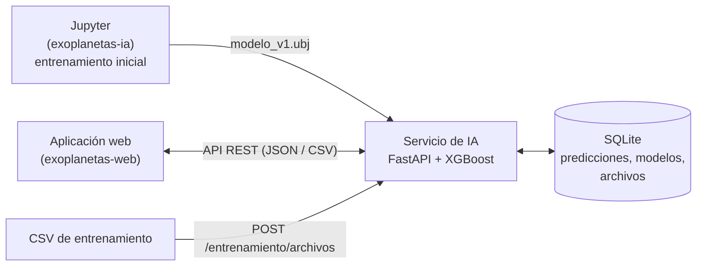
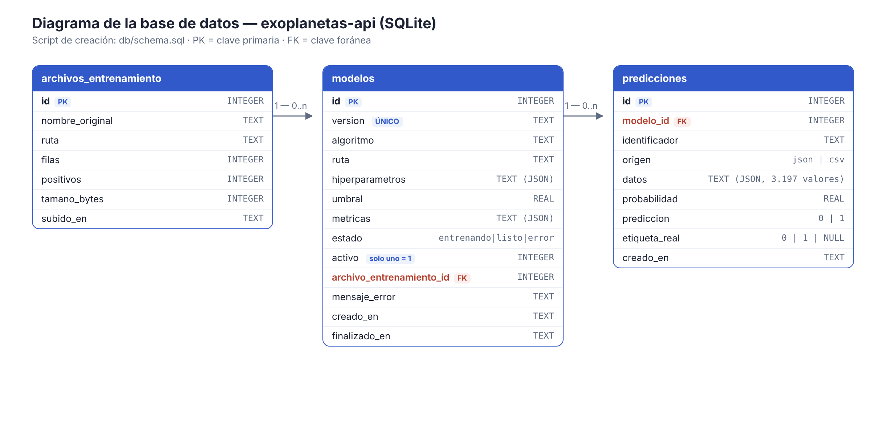
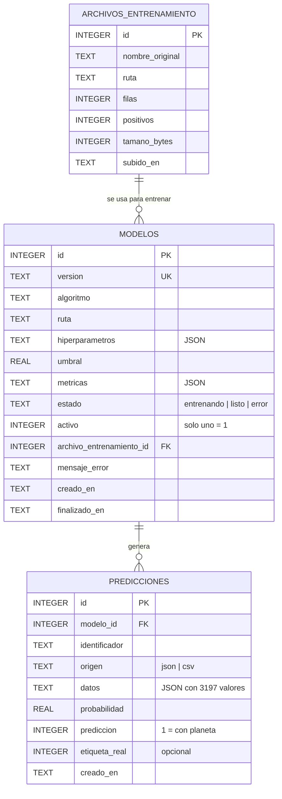

# Exoplanetas IA — Servicio de IA (API REST)

Servicio web que expone el modelo de detección de exoplanetas mediante una **API REST**. Recibe la curva de luz de una estrella, que son 3.197 mediciones de brillo del telescopio Kepler, y devuelve si la estrella tiene un exoplaneta. Además guarda el historial de predicciones, informa las métricas del modelo y permite reentrenarlo con datos nuevos.

Proyecto final de **Taller de Sistemas Inteligentes**. Está compuesto por tres repositorios:

| Repositorio | Contenido |
|---|---|
| [exoplanetas-ia](https://github.com/lgabs5888/exoplanetas-ia) | Notebooks de entrenamiento y evaluación (CRISP-ML(Q), fases 1 a 4) |
| **exoplanetas-api** (este) | Servicio de IA: API REST, base de datos y modelo en producción |
| [exoplanetas-web](https://github.com/lgabs5888/exoplanetas-web) | Aplicación web cliente que consume todos los endpoints |

## Arquitectura



- **Lenguaje:** Python 3.10+ con FastAPI.
- **Modelo:** XGBoost sobre el espectro de Fourier de la curva limpia. El preprocesamiento está en `app/preprocesamiento.py` y es una copia exacta de `src/preprocesamiento.py` del repositorio de entrenamiento: así la API transforma los datos igual que en el entrenamiento.
- **Base de datos:** SQLite, un archivo que se crea solo. El esquema está en [`db/schema.sql`](db/schema.sql).

## Endpoints

| Método | Ruta | Requisito | Descripción |
|---|---|---|---|
| `POST` | `/predicciones` | a | Clasifica una curva de luz enviada como JSON (`{"flux": [3197 valores]}`) |
| `POST` | `/predicciones/archivo` | a | Clasifica todas las filas de un CSV (`FLUX.1` … `FLUX.3197`, `LABEL` opcional) |
| `GET` | `/predicciones` | b | Historial paginado de predicciones: resultado, probabilidad, fecha y modelo |
| `GET` | `/predicciones/{id}` | b | Detalle de una predicción con los **datos enviados** |
| `GET` | `/modelo/metricas` | c | Métricas del modelo activo: validación cruzada, prueba y monitoreo en uso |
| `GET` | `/modelo/versiones` | c | Todas las versiones del modelo con sus métricas |
| `GET` | `/modelo/versiones/{id}` | d | Estado de una versión (para seguir un reentrenamiento) |
| `PUT` | `/modelo/versiones/{id}/activar` | d | Vuelve a activar una versión anterior (rollback) |
| `POST` | `/modelo/reentrenar` | d | Reentrena el modelo en segundo plano con un archivo enviado |
| `POST` | `/entrenamiento/archivos` | e | Envía un archivo de entrenamiento (CSV con `LABEL`) |
| `GET` | `/entrenamiento/archivos` | e | Lista los archivos de entrenamiento enviados |
| `GET` | `/salud` | — | Estado del servicio y versión activa |

**Documentación Swagger:**
- Interactiva: `http://localhost:8000/docs`, desde donde se puede probar cada endpoint.
- Alternativa: `http://localhost:8000/redoc`.
- Archivo: [`docs/openapi.yaml`](docs/openapi.yaml) y [`docs/openapi.json`](docs/openapi.json). Se regeneran con `python scripts/exportar_openapi.py`.

## Instalación y ejecución

```bash
git clone https://github.com/lgabs5888/exoplanetas-api.git
cd exoplanetas-api
python -m venv .venv
source .venv/bin/activate          # Windows: .venv\Scripts\activate
pip install -r requirements.txt
uvicorn app.main:app --reload
```

La API queda en `http://localhost:8000`. Al iniciar, crea la base de datos en `almacenamiento/exoplanetas.db` y registra el modelo inicial `modelos/modelo_v1.ubj` como versión activa. El modelo se guarda en el formato nativo de XGBoost, que no depende de la versión de Python.

**Pruebas automáticas:**

```bash
pytest
```

Las pruebas cubren todos los endpoints, incluido un reentrenamiento completo y el rollback a la versión anterior.

## Base de datos





**Generación:** el script [`db/schema.sql`](db/schema.sql) se ejecuta automáticamente al iniciar la API (`app/db.py`). Para crear la base a mano:

```bash
sqlite3 almacenamiento/exoplanetas.db < db/schema.sql
```

- **`archivos_entrenamiento`:** archivos CSV enviados para reentrenar.
- **`modelos`:** cada versión del modelo, con sus hiperparámetros, umbral y métricas. Un índice único parcial garantiza que solo haya una versión activa.
- **`predicciones`:** el historial. Guarda los datos enviados, el resultado, la probabilidad, el modelo que la hizo y, si el CSV traía `LABEL`, la etiqueta real. Con esa etiqueta se calcula el monitoreo en uso de `/modelo/metricas`.

## Reentrenamiento

1. `POST /entrenamiento/archivos` con un CSV en el formato de `exoTrain.csv`. Debe tener al menos 5 estrellas con planeta.
2. `POST /modelo/reentrenar` con `{"archivo_id": 1, "activar": true}`. Responde `202` y el entrenamiento corre en segundo plano.
3. El servicio aplica el mismo preprocesamiento y hace una validación cruzada estratificada de 5 pliegues para calcular las métricas. Elige el umbral que maximiza F1 y entrena la versión final con todos los datos.
4. `GET /modelo/versiones/{id}` muestra el estado: `entrenando`, `listo` o `error`. Si `activar` era verdadero, la nueva versión pasa a ser la activa.
5. Si la nueva versión es peor, `PUT /modelo/versiones/{id}/activar` vuelve a la anterior.

Solo se permite un reentrenamiento a la vez.

## Ejemplo con curl

```bash
# Clasificar un CSV
curl -F "archivo=@estrella.csv" http://localhost:8000/predicciones/archivo

# Historial
curl "http://localhost:8000/predicciones?limite=10"

# Métricas
curl http://localhost:8000/modelo/metricas
```
